#  Clínica Médica Vida Plus — Aplicativo Android

> Aplicativo mobile para gestão de consultas médicas, desenvolvido em Java com Android Studio.
>
> Curso: Desenvolvimento de Software Multiplataforma — 4º Semestre
>
> Aluno: Milton Wagner Filho
>
> Professora: Simone Mendes
>
> Ano: 1/2026
>
> Branch `adriel-lint`: Adriel Rattes — marketplace de médicos, área do médico, fila ao vivo, videochamada, CI e Lint

---

## Sumário

- [Sobre o Projeto](#sobre-o-projeto)
- [Download do APK](#download-do-apk)
- [Funcionalidades](#funcionalidades)
- [Telas do Aplicativo](#telas-do-aplicativo)
- [Tecnologias](#tecnologias)
- [Arquitetura](#arquitetura)
- [Banco de Dados (Firestore)](#banco-de-dados-firestore)
- [Estrutura de Arquivos](#estrutura-de-arquivos)
- [Pre-requisitos](#pre-requisitos)
- [Como Executar](#como-executar)
- [Integração Contínua](#integração-contínua)
- [Conceitos Implementados](#conceitos-implementados)
- [Referencias](#referencias)

---

## Sobre o Projeto

**Clínica Médica Vida Plus** é um aplicativo Android que conecta pacientes e médicos. O paciente encontra um médico no marketplace (sem precisar de login para olhar), agenda uma consulta presencial ou online, ou entra na **fila de atendimento ao vivo** e é atendido por **videochamada** dentro do próprio app. O médico tem um painel com a fila do dia, agenda, prontuário dos pacientes e carteira.

O projeto foi desenvolvido como trabalho acadêmico do curso de Desenvolvimento de Software Multiplataforma, aplicando na prática os quatro conceitos principais vistos em aula: banco de dados local (ROOM), banco de dados remoto (Firebase Firestore), autenticação com Google e geolocalização com OpenStreetMap.

---

## Download do APK

Cada push nesta branch gera um APK novo pelo GitHub Actions:

**[ClinicaVidaPlus.apk (adriel-lint)](https://github.com/miltonwagner/P2-projeto-clinica-medica-android/releases/download/apk-adriel-lint/ClinicaVidaPlus.apk)**

O app avisa sozinho quando sai uma versão nova ("Atualizar aplicativo?"), baixa e instala por cima.

---

## Funcionalidades

### Paciente

| Funcionalidade | Descrição |
|---|---|
| Marketplace de médicos | Busca por nome, chips de especialidade e ordenação (relevância, melhor avaliação, menor preço); selo de quem está online — aberto antes do login |
| Perfil do médico | Especialidade, CRM, valor, avaliação, apresentação e modos de atendimento |
| Agendamento | Online ou presencial, calendário de 60 dias (sem domingo), horários ocupados e já passados desabilitados |
| Fila ao vivo | Entra na fila de um médico online, vê a posição e o tempo estimado em tempo real |
| Videochamada | Quando o médico chama ("É a sua vez"), a consulta acontece por vídeo dentro do app (Jitsi Meet) |
| Minhas consultas | Lista de agendamentos com status e botão de vídeo nas consultas online em atendimento |
| Carteira e Perfil | Gastos com consultas, dados pessoais e sair |
| Cadastro e Login | E-mail/senha ou Google, recuperação de senha; quem escolheu um médico antes de logar volta direto para o agendamento |
| Localização | Mapa OpenStreetMap com a clínica e o GPS do usuário |

### Médico

| Funcionalidade | Descrição |
|---|---|
| Painel (Visão geral) | Switch "online", modo de atendimento (ao vivo, agendamento ou os dois) e a fila de hoje em tempo real |
| Atendimento | Confirmar, recusar, chamar, iniciar videochamada e concluir |
| Agenda | Consultas futuras do médico |
| Pacientes e Prontuário | Lista de pacientes atendidos e anotações por paciente (visíveis só para o médico que escreveu) |
| Carteira | Valores recebidos por consulta |

### Admin

| Funcionalidade | Descrição |
|---|---|
| Autorizar médicos | Médico só entra na área dele depois que o admin autoriza o cadastro |

---

## Telas do Aplicativo

> As fotos abaixo são geradas automaticamente pelo workflow **Fotos das telas** (emulador no GitHub Actions entrando com as contas de teste) e ficam em [`docs/telas`](docs/telas).

### Visitante

<p align="center">
  
  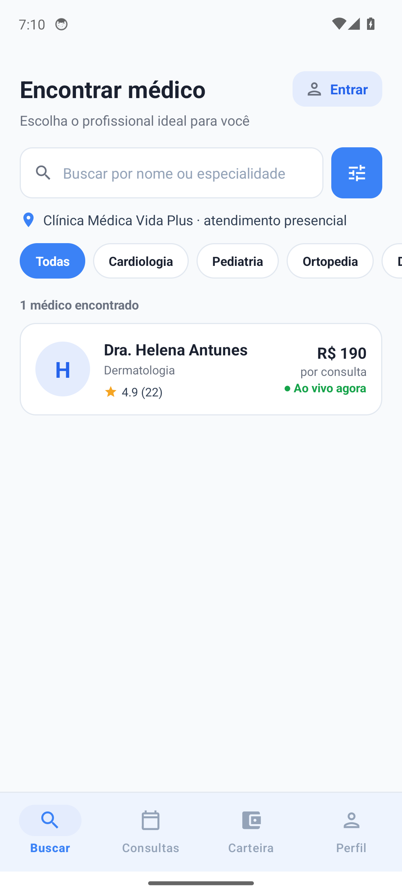
  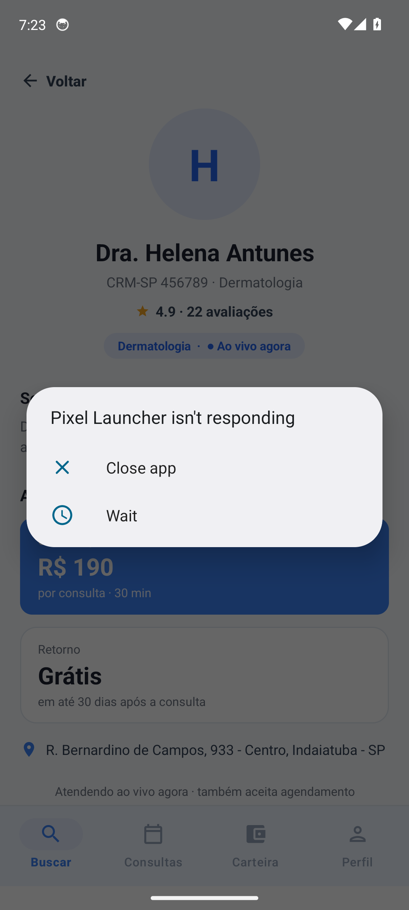
</p>
<p align="center">
  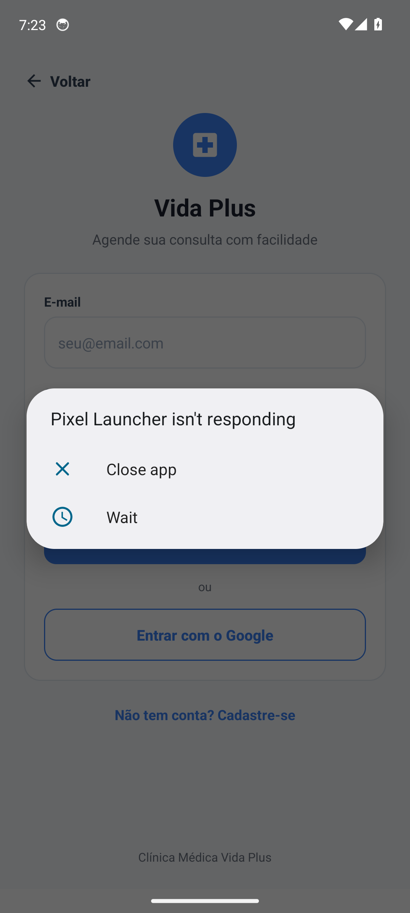
  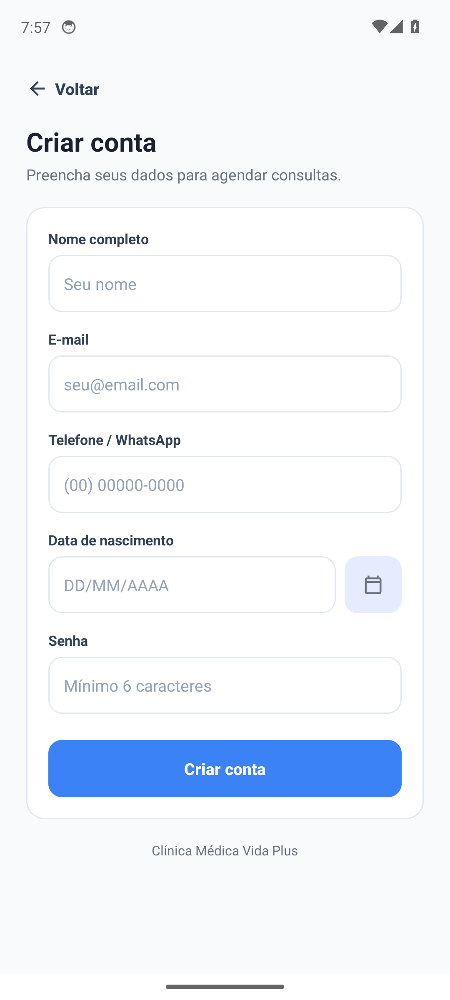
  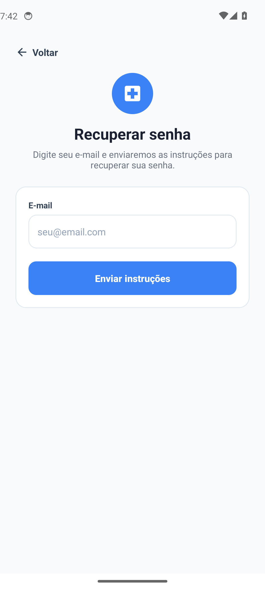
  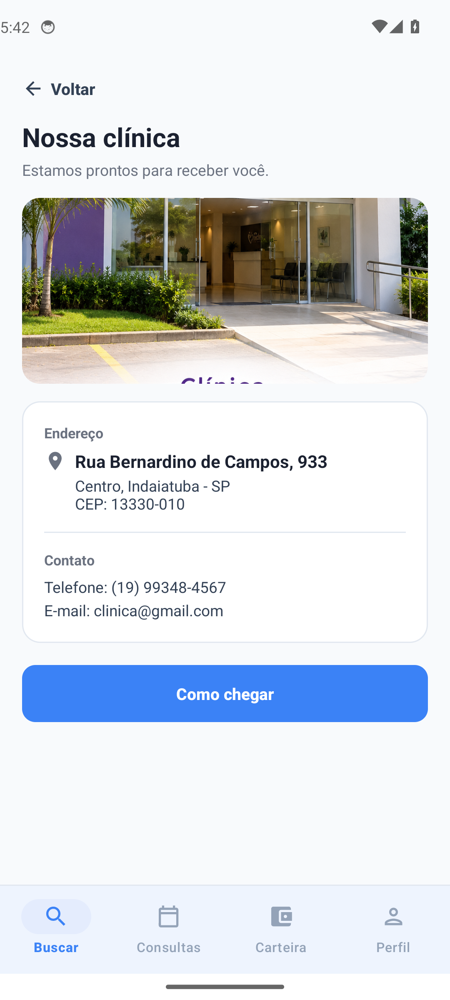
</p>

### Paciente

<p align="center">
  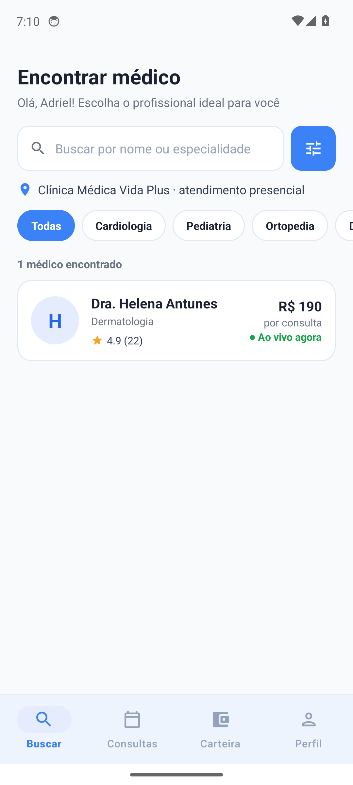
  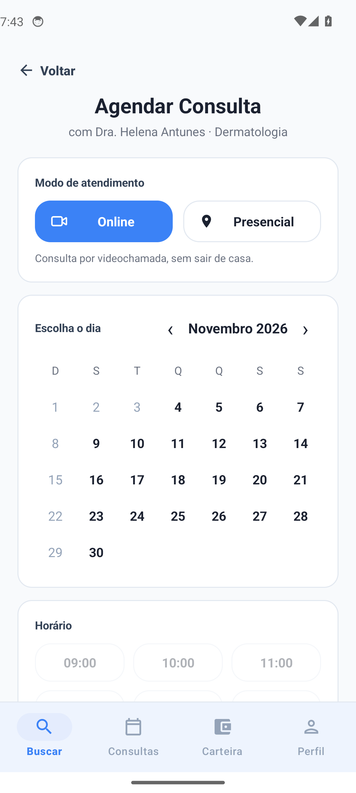
  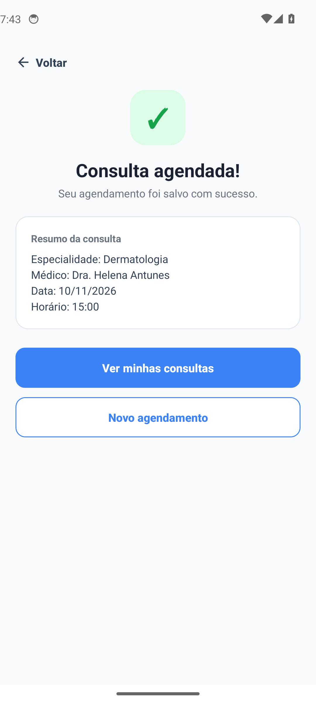
  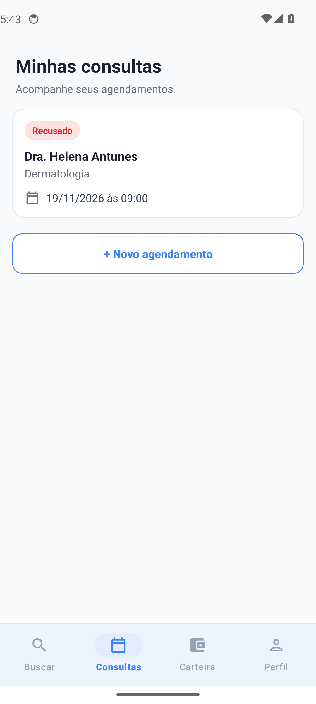
</p>
<p align="center">
  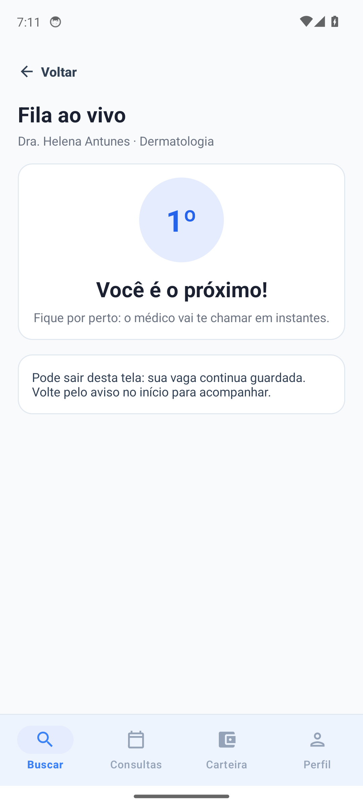
  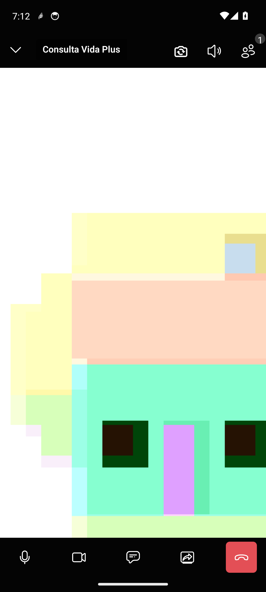
  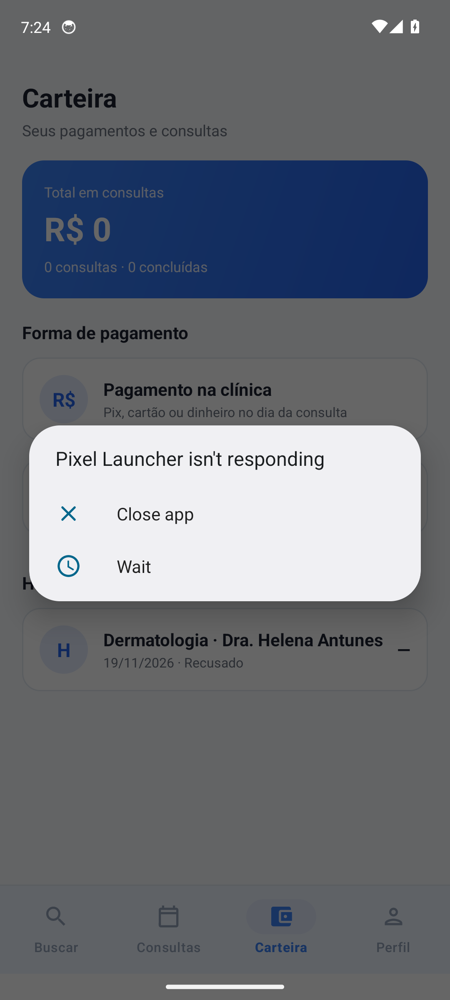
  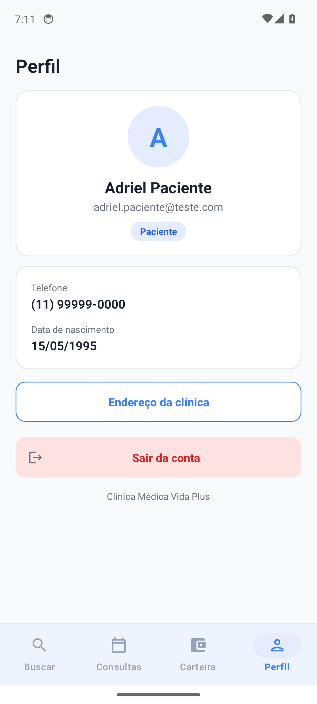
</p>

### Médico

<p align="center">
  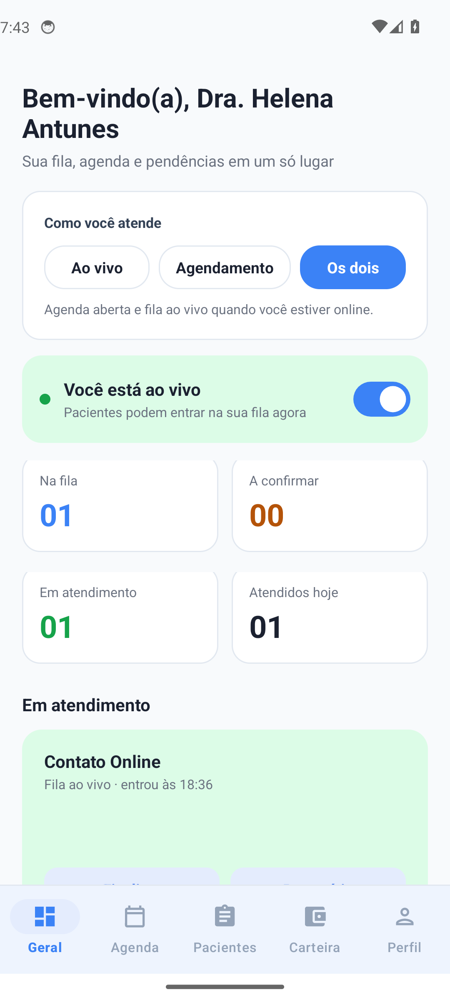
  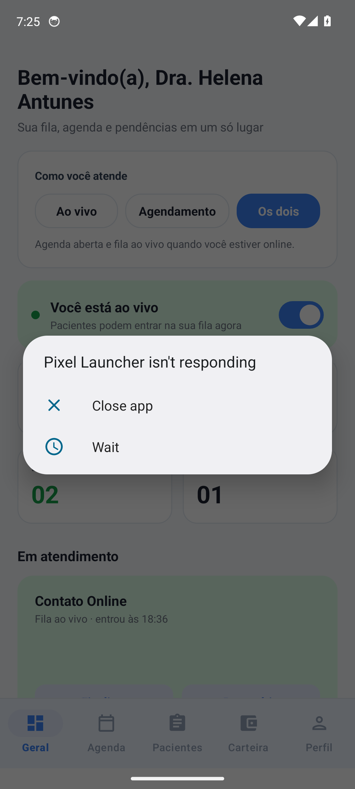
  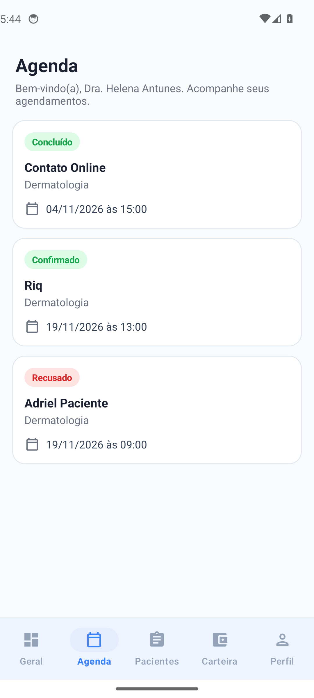
</p>
<p align="center">
  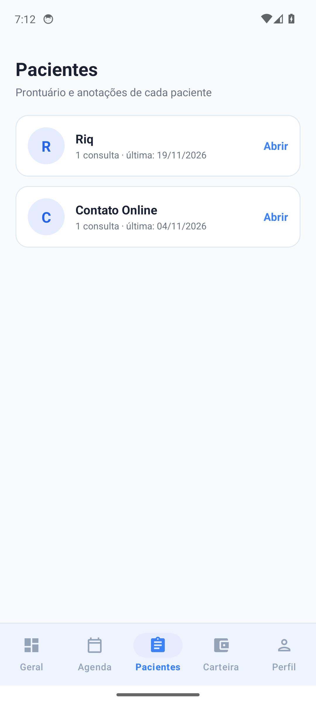
  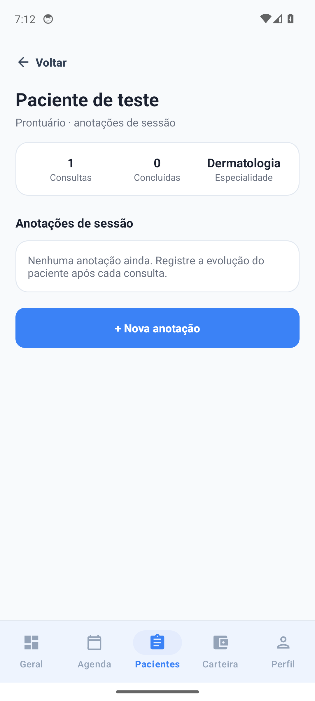
  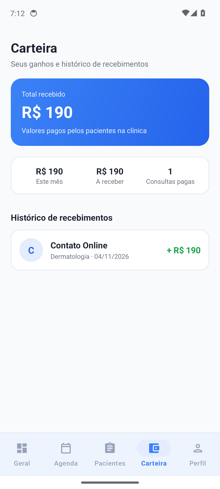
  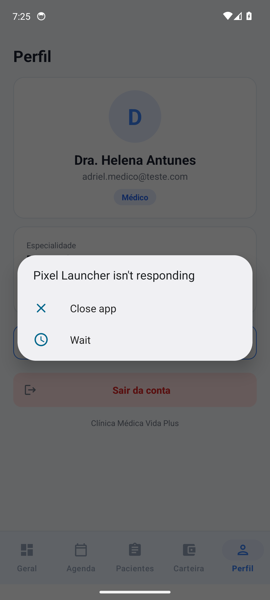
</p>

| Tela | Activity | Descrição |
|---|---|---|
| Inicial | `IndexActivity` | Entrada do app (visitante vai ao marketplace) |
| Login / Cadastro | `LoginActivity`, `MainActivity`, `EsqueceuSenhaActivity` | E-mail/senha, Google e recuperação de senha |
| Marketplace | `MarketplaceActivity` | Busca e filtro de médicos |
| Perfil do médico | `PerfilMedicoActivity` | Detalhes e botões "Agendar" / "Entrar na fila" |
| Agendar | `AgendarActivity`, `AgendamentoSucessoActivity` | Modo, dia, horário e dados do paciente |
| Fila ao vivo | `FilaActivity` | Sala de espera com posição e videochamada |
| Minhas consultas | `ListaConsultasActivity` | Histórico e consultas futuras do paciente |
| Painel do médico | `DashboardMedicoActivity` | Online, modo de atendimento e fila do dia |
| Agenda do médico | `ListaConsultasMedicoActivity` | Consultas do médico |
| Pacientes / Prontuário | `AnotacoesActivity`, `ProntuarioActivity` | Anotações por paciente |
| Carteira / Perfil | `CarteiraActivity`, `PerfilActivity` | Valores e dados do usuário |
| Admin | `AdminMedicosActivity` | Autorização de médicos |
| Localização | `EnderecoActivity` | Mapa OSM com pin da clínica e GPS do usuário |

---

## Tecnologias

| Categoria | Tecnologia | Finalidade |
|---|---|---|
| IDE | Android Studio | Desenvolvimento do app Android |
| Linguagem | Java | Lógica do aplicativo |
| Banco Local | ROOM (SQLite) | Armazenamento offline dos dados do paciente |
| Banco Remoto | Firebase Firestore | Médicos, pacientes, agendamentos, fila e prontuário em tempo real |
| Autenticação | Firebase Authentication | Login com e-mail/senha e Google |
| Login Social | Google Sign-In | Autenticação simplificada com conta Google |
| Videochamada | Jitsi Meet SDK 13.3 | Consulta por vídeo dentro do app (servidor meet.ffmuc.net) |
| Geolocalização | FusedLocationProviderClient | Obtenção das coordenadas GPS do usuário |
| Mapa | OpenStreetMap + osmdroid | Exibição do mapa interativo sem API Key |
| E-mail | JavaMail (SMTP Gmail) | Confirmação de agendamento por e-mail |
| Backend Serverless | Firebase Cloud Functions | Gatilho de e-mail via Firestore |
| Qualidade | Android Lint + pre-commit | Bloqueia commit com erro de Lint |
| CI/CD | GitHub Actions + Releases | APK a cada push, fotos das telas e atualização dentro do app |

---

## Arquitetura

```
┌──────────────────────────────────────────────────────────┐
│                Camada de Apresentação                    │
│  Activities + Layouts XML + NavegacaoInferior (por perfil)│
│  Visitante/Paciente: Marketplace, PerfilMedico, Agendar, │
│    Fila, ListaConsultas, Carteira, Perfil                │
│  Médico: DashboardMedico, ListaConsultasMedico,          │
│    Anotacoes, Prontuario    ·   Admin: AdminMedicos       │
└───────────────┬──────────────────────────┬───────────────┘
                │                          │
┌───────────────▼──────────────┐ ┌─────────▼───────────────┐
│  Lógica / Serviços           │ │  Integrações            │
│  Sessao (perfil e retorno)   │ │  Videochamada (Jitsi)   │
│  PacienteRepository          │ │  Atualizador (Releases) │
│  Medico, Consulta, EntradaFila│ │  EmailSender (SMTP)     │
└───────┬───────────────┬──────┘ └─────────────────────────┘
        │               │
┌───────▼──────┐ ┌──────▼──────────────────────────────────┐
│ Banco LOCAL  │ │ Banco REMOTO — Firebase Firestore       │
│ ROOM (SQLite)│ │ medicos · pacientes · agendamentos      │
│ clinica_db   │ │ fila · anotacoes  (+ regras de acesso)  │
└──────────────┘ └─────────────────────────────────────────┘
```

---

## Banco de Dados (Firestore)

| Coleção | Conteúdo | Quem acessa |
|---|---|---|
| `medicos` | nome, especialidade, CRM, valor, bio, avaliação, `online`, `atendimento` (aovivo/agendamento/ambos), `autorizado` | Leitura pública; o médico altera só online/bio/atendimento; admin autoriza |
| `pacientes` | Cadastro do paciente | O próprio paciente, médicos autorizados e admin |
| `agendamentos` | médico, data, horário, modalidade, motivo, valor, status (Agendado → Confirmado → Em atendimento → Concluído) | Paciente cria/acompanha; médico muda o status |
| `fila` | pacienteId, medicoId, status (aguardando/em_atendimento/atendido/cancelado), entrouEm | Paciente entra/sai; médico chama e finaliza |
| `anotacoes` | Prontuário do paciente | Só o médico que escreveu |

As regras ficam em [`firestore.rules`](firestore.rules) e somam as da master (`medicos_publicos`, `horarios_ocupados`) com as desta branch.

---

## Estrutura de Arquivos

```
├── .github/workflows/
│   ├── build-apk-adriel.yml        # APK + release apk-adriel-lint a cada push
│   └── fotos-telas.yml             # Emulador fotografa todas as telas → docs/telas
├── app/
│   ├── build.gradle.kts
│   └── src/
│       ├── main/java/com/example/clinicavidaplus/
│       │   ├── IndexActivity, LoginActivity, MainActivity, EsqueceuSenhaActivity
│       │   ├── MarketplaceActivity, PerfilMedicoActivity, AgendarActivity,
│       │   │   AgendamentoSucessoActivity, FilaActivity, ListaConsultasActivity
│       │   ├── DashboardMedicoActivity, ListaConsultasMedicoActivity,
│       │   │   AnotacoesActivity, ProntuarioActivity, AdminMedicosActivity
│       │   ├── CarteiraActivity, PerfilActivity, EnderecoActivity
│       │   ├── NavegacaoInferior, Sessao, Tela         # navegação e sessão
│       │   ├── Medico, Consulta, EntradaFila           # modelos do Firestore
│       │   ├── Videochamada, Atualizador, EmailSender  # integrações
│       │   └── Paciente, PacienteDao, AppDatabase, PacienteRepository  # ROOM
│       └── androidTest/.../CapturaTelasTest.java      # gera as fotos das telas
├── docs/telas/                     # prints gerados pelo CI
├── scripts/capturar_telas.sh
├── firestore.rules · firebase.json
├── functions/                      # Cloud Functions (e-mail)
└── README.md
```

---

## Pre-requisitos

- Android Studio Hedgehog ou superior
- JDK 21 (o mesmo do CI) — JDK 17 também compila
- Conta no Firebase com projeto configurado (`app/google-services.json`, fora do Git)
- Dispositivo físico ou emulador com **Android 8.0 (API 26)** ou superior — exigência do SDK do Jitsi

---

## Como Executar

1. Clone o repositório e troque para a branch: `git checkout adriel-lint`
2. Coloque o `app/google-services.json` do projeto Firebase e crie `local.properties` com `sdk.dir=...`
3. Abra no Android Studio e aguarde o Gradle sincronizar
4. Conecte um celular (depuração USB) ou inicie um emulador e clique em **Run ▶**

> O APK local só inclui `arm64-v8a`/`armeabi-v7a` (celulares). Para emulador x86_64, compile com `./gradlew assembleDebug -PtodasAbis=1`.

Ou simplesmente instale o [APK do CI](#download-do-apk).

---

## Integração Contínua

| Workflow | Quando roda | O que faz |
|---|---|---|
| `build-apk-adriel.yml` | Push na `adriel-lint` | Compila, assina com a chave de debug compartilhada, publica `ClinicaVidaPlus.apk` + `versao.json` no release `apk-adriel-lint` |
| `fotos-telas.yml` | Manual ou push em layouts/teste de captura | Sobe um emulador Android 14, entra como visitante, paciente e médico de teste e salva um PNG de cada tela em `docs/telas` |

Secrets usados: `GOOGLE_SERVICES_JSON`, `DEBUG_KEYSTORE`, `VIDAPLUS_SENHA_TESTE`.

### Lint e pre-commit (novos integrantes)

O commit roda o Android Lint automaticamente (`./gradlew lintDebug`) e é bloqueado se houver erro.

1. Instale o Python e o pre-commit: `pip install pre-commit`
2. Na raiz do projeto: `pre-commit install`
3. Crie `local.properties` com `sdk.dir=C:/caminho/do/Sdk` e coloque seu `app/google-services.json` (ambos ficam fora do Git).
4. Teste: `pre-commit run --all-files`

Rodar o Lint manualmente: `./gradlew lint` — relatório em `app/build/reports/lint-results-debug.html`.

---

## Conceitos Implementados

### 1. Conexão Local — ROOM

Biblioteca Android de persistência local baseada em SQLite. Ao cadastrar, os dados do paciente são salvos no banco local `clinica_db` (tabela `pacientes`) via `PacienteRepository`, permitindo acesso offline.

### 2. Conexão Remota — Firebase Firestore

Banco de dados NoSQL em nuvem. Médicos, agendamentos, fila e prontuário são sincronizados em tempo real com *snapshot listeners*: o paciente vê sua posição na fila mudar e o médico vê novos pacientes chegando sem atualizar a tela. Regras de segurança limitam o que cada perfil pode ler e alterar.

### 3. Autenticação com Google

Implementada via Firebase Authentication com Google Sign-In. O perfil (paciente, médico ou admin) é identificado no login e define a tela inicial e o menu inferior.

### 4. Geolocalização

Utiliza `FusedLocationProviderClient` para obter as coordenadas GPS do usuário e a biblioteca `osmdroid` para renderizar o mapa OpenStreetMap com um marcador fixo na clínica e outro marcador dinâmico na posição atual do usuário.

### Extras desta branch

- **Videochamada** com Jitsi Meet SDK: sala única por consulta/fila (`VidaPlus` + id do documento).
- **Atualização dentro do app**: lê `versao.json` do GitHub Releases e instala o APK novo com `DownloadManager` + `FileProvider`.
- **Qualidade**: Android Lint no pre-commit e build automatizado no GitHub Actions.

---

## Referencias

- Firebase Documentation. Google LLC. Disponível em: https://firebase.google.com/docs
- Android Developers — ROOM. Disponível em: https://developer.android.com/training/data-storage/room
- osmdroid — OpenStreetMap Tools for Android. Disponível em: https://github.com/osmdroid/osmdroid
- Google Sign-In for Android. Disponível em: https://developers.google.com/identity/sign-in/android
- Jitsi Meet Android SDK. Disponível em: https://jitsi.github.io/handbook/docs/dev-guide/dev-guide-android-sdk
- Android Developers Documentation. Disponível em: https://developer.android.com/docs

---

> **Clínica Médica Vida Plus** — Rua Bernardino de Campos, 933, Centro, Indaiatuba – SP
>
> Telefone: (19) 99999.9999 | E-mail: clinica@gmail.com
>
> © 2026 Clínica Médica Vida Plus
